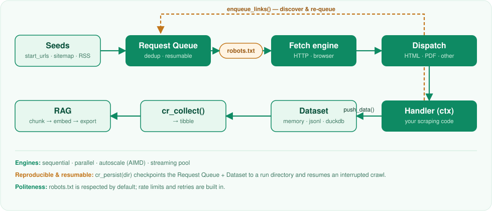
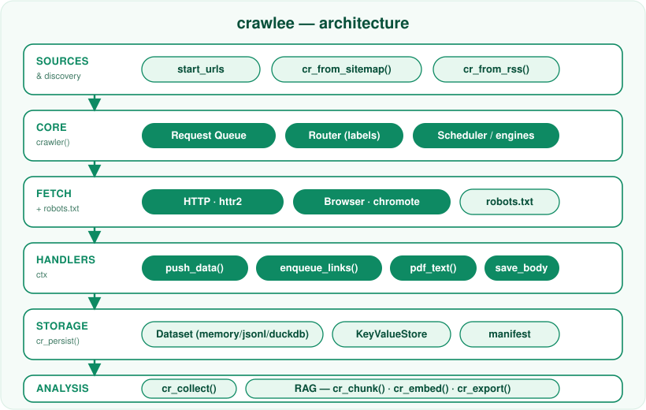

# crawlee

**crawlee** is an **R reimplementation of the design and vocabulary of
[Crawlee](https://crawlee.dev)**, the web-crawling library for Node.js
and Python created by [Apify](https://apify.com)
([apify/crawlee](https://github.com/apify/crawlee)). The architecture —
a unified crawler around a request queue, a dataset and a key-value
store, with labelled handlers and an autoscaled pool — is Crawlee’s, and
that design is Apify’s work. This package is not a wrapper around
Crawlee and not a translation of its source code: it is R code written
for this package, with a tidy `cr_*` interface on top (see [Relationship
to Crawlee](#relationship-to-crawlee)).

> crawlee (the R package) is an independent project: it is not
> affiliated with, maintained by or endorsed by Apify. “Crawlee” and
> “Apify” are names and trademarks of Apify Technologies s.r.o. It was
> written with the assistance of AI coding tools.

It brings the unified-crawler idea to R: a deduplicating, resumable
request queue, content-type aware handlers, structured storage and rich
console logging via [cli](https://cli.r-lib.org). It can crawl HTML
pages, sitemaps, RSS and Atom feeds and PDF documents — with
reproducibility as a first-class concern.

It is built entirely on the R web-scraping ecosystem
([httr2](https://httr2.r-lib.org), [rvest](https://rvest.tidyverse.org),
[xml2](https://xml2.r-lib.org),
[chromote](https://rstudio.github.io/chromote/)) — no Node.js runtime
required.

## How it works

A crawl is a loop: requests flow through a deduplicating queue to a
fetch engine; each response is dispatched to a handler that extracts
data (`push_data()`) and discovers more links (`enqueue_links()`), which
flow back into the queue until it drains.



## Architecture



## Installation

``` r

# install.packages("pak")
pak::pak("StrategicProjects/crawlee")
```

## Usage

``` r

library(crawlee)

resultado <- crawler("https://example.com") |>
  cr_options(delay = 0.5, max_depth = 2, respect_robots = TRUE) |>
  cr_use_http() |>
  cr_on_html(function(ctx) {
    ctx$push_data(list(
      url    = ctx$request$url,
      titulo = ctx$page |> rvest::html_element("h1") |> rvest::html_text2()
    ))
    ctx$enqueue_links(glob = "*/blog/*")
  }) |>
  cr_run() |>
  cr_collect()

resultado
#> # A tibble: 1 × 2
#>   url                 titulo
#>   <chr>               <chr>
#> 1 https://example.com Example Domain
```

## Design principles

- **Reproducibility first** — deduplicating, resumable request queue;
  runs are meant to be deterministic and re-runnable.
- **No heavy mandatory dependencies** — DuckDB, chromote and pdftools
  are optional (`Suggests`), loaded only when used.
- **Tidy & predictable** — `cr_*` verbs compose with the native pipe and
  always return tibbles.
- **A polite web citizen** — rate limiting and `robots.txt` awareness by
  default.

## Relationship to Crawlee

[Crawlee](https://crawlee.dev) is developed by
[Apify](https://apify.com) and distributed under the Apache License 2.0
([source](https://github.com/apify/crawlee)). This package takes its
design from Crawlee and its name from it; it contains none of Crawlee’s
code.

What follows Crawlee:

- the overall architecture: one crawler that owns a request queue,
  storage and handlers, and runs until the queue drains;
- the vocabulary: `RequestQueue`, `Dataset`, `KeyValueStore`, `Crawler`,
  the handler context with `push_data()` and `enqueue_links()`, request
  labels that route requests to handlers;
- the split of storage into request queue, dataset and key-value store;
- concurrency modelled on Crawlee’s autoscaled pool
  ([`cr_autoscale()`](https://strategicprojects.github.io/crawlee/reference/cr_autoscale.md),
  [`cr_stream()`](https://strategicprojects.github.io/crawlee/reference/cr_stream.md));
- the guides: the articles on this site follow the path of Crawlee’s own
  guides.

What is different:

- the implementation: R6 classes on top of httr2, rvest, xml2 and
  (optionally) chromote, written for this package — no Node.js or Python
  runtime, and no call into Crawlee;
- the interface: pipe-friendly `cr_*` verbs that return tibbles;
- the scope: only a part of Crawlee is covered (no session pool, proxy
  rotation or browser fingerprinting, for instance), and some things
  here are not in Crawlee — PDF handlers, the
  [`cr_chunk()`](https://strategicprojects.github.io/crawlee/reference/cr_chunk.md)/[`cr_embed()`](https://strategicprojects.github.io/crawlee/reference/cr_embed.md)/[`cr_export()`](https://strategicprojects.github.io/crawlee/reference/cr_export.md)
  helpers for retrieval-augmented generation, DuckDB and Parquet
  storage.

Behaviour is not guaranteed to match Crawlee’s. For Crawlee itself, see
<https://crawlee.dev>.

## Roadmap

| Milestone | Scope | Status |
|----|----|----|
| **M1** | Core: queue, HTTP, HTML handlers, dataset, cli logs | ✅ |
| **M2** | Sitemap & RSS discovery, robots.txt enforcement | ✅ |
| **M3** | PDF / document handlers (`pdftools`) | ✅ |
| **M4** | Headless browser backend (`chromote`) | ✅ |
| **M5** | RAG helpers (chunking, embeddings, export) | ✅ |
| **M6** | Persistent & resumable storage (jsonl/duckdb, [`cr_persist()`](https://strategicprojects.github.io/crawlee/reference/cr_persist.md)) | ✅ |
| **M7** | Parallel fetching ([`cr_parallel()`](https://strategicprojects.github.io/crawlee/reference/cr_parallel.md)) | ✅ |
| **M8** | Autoscaling ([`cr_autoscale()`](https://strategicprojects.github.io/crawlee/reference/cr_autoscale.md)) & streaming pool ([`cr_stream()`](https://strategicprojects.github.io/crawlee/reference/cr_stream.md)) | ✅ |
| **M9** | Adaptive streaming + per-host pacing | ✅ |

## License

MIT © crawlee (R package) authors. Crawlee, the library this package is
modelled on, is © Apify Technologies s.r.o. and licensed under
Apache-2.0; none of its code is included here.
